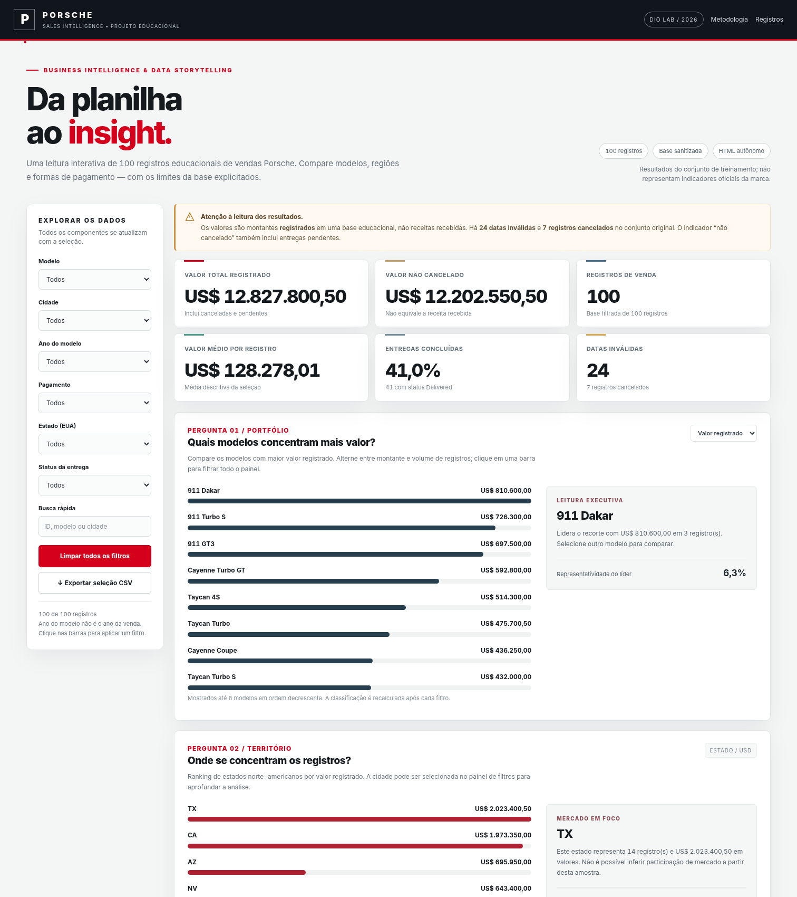
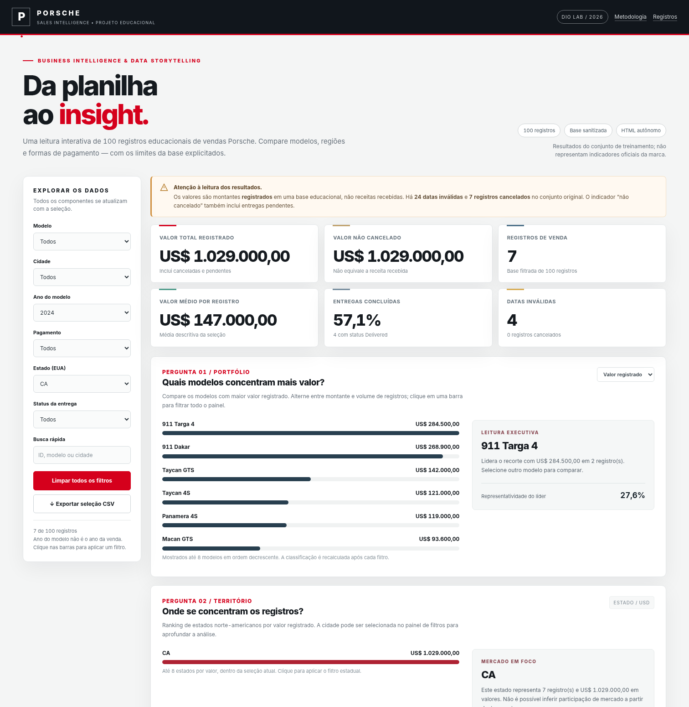

# Porsche | Sales Intelligence — Dashboard de Vendas em HTML

> Projeto educacional desenvolvido para o desafio **Dashboard de Vendas Porsche**, da DIO. Uma base de 100 registros foi transformada em um painel responsivo, com filtros realmente funcionais e dados incorporados diretamente ao `index.html`.

**[Abrir o dashboard publicado — após ativar o GitHub Pages](https://erisvaldolessa.github.io/dashboard-vendas-porsche-html/)** · [Executar localmente](index.html) · [Metodologia](METODOLOGIA_E_TESTES.md)

## Visão geral



**Exemplo de dois filtros simultâneos: estado CA e ano do modelo 2024** — o painel passa a exibir sete registros, com KPIs e gráficos atualizados.



[Ver prévia em dispositivos móveis](dashboard_mobile.png)

## O problema de negócio

Em vez de simplesmente apresentar muitos gráficos, o dashboard responde a **três perguntas**:

1. **Quais modelos concentram mais valor registrado?** Ranking interativo por modelo, com alternância entre valor e quantidade, mais destaque para o líder e sua participação.
2. **Onde se concentram os registros?** Ranking de estados dos EUA por valor, com seleção direta nas barras e aprofundamento por cidade nos filtros.
3. **Como os registros foram pagos e entregues?** Distribuição do valor por forma de pagamento e composição de status operacionais (entregue, cancelado, demais etapas).

Há ainda uma seção de **qualidade e limitações** e uma tabela auditável dos registros filtrados.

## Indicadores e funcionalidades

- Filtros combináveis por **modelo, cidade, ano do modelo, meio de pagamento, estado e status da entrega**.
- Busca por ID, modelo, cidade ou estado; clique em uma barra para filtrar todos os componentes.
- **Seis KPIs** atualizados em tempo real: valor registrado, valor não cancelado, número de registros, valor médio, percentual entregue e quantidade de datas inválidas.
- Três blocos de perguntas de negócio, barras comparativas e visual de composição da entrega.
- Tabela paginada, ordenada por maior valor, e **exportação CSV do subconjunto filtrado**.
- Layout responsivo, teclado suportado, sem bibliotecas, fontes, APIs ou imagens externas.

## Dados e decisões de tratamento

Fonte: planilha didática **“Planilha base Porsche (sanitizada)”**, fornecida no desafio. O arquivo original não está incluído no repositório para evitar redistribuir campos identificáveis desnecessariamente. Um extrato mínimo, sem nomes de clientes e vendedores, está disponível em [`dados_sanitizados.csv`](dados_sanitizados.csv). O HTML embute esses mesmos 100 registros.

| Controle | Resultado na base integral |
|---|---:|
| Registros únicos (`sale_id`) | **100** |
| Modelos distintos | **40** |
| Valor bruto registrado | **US$ 12.827.800,50** |
| Valor de registros não cancelados | **US$ 12.202.550,50** |
| Status Delivered | **41** |
| Status Cancelled | **7** |
| Datas marcadas como `INVALID` | **24** |
| Estados distintos | **33** |

**Atenção:** a base contém períodos de 2024 a 2027 e deve ser entendida como **material educacional**, não como demonstrativo da empresa. O valor registrado não corresponde necessariamente a receita recebida, especialmente quando o status é cancelado, pendente ou em trânsito. “Não cancelado” apenas exclui os registros `Cancelled`: não confirma pagamento. Datas inválidas permanecem ausentes; não há preenchimento inventado. "Ano do modelo" não representa "ano da venda".

Os dados de preço foram extraídos da coluna `SalesPriceSanitized` e tratados como **USD**, conforme os valores da origem. Os demais atributos vieram das colunas previamente sanitizadas.

## Executar e reproduzir

1. Baixe o repositório (ou apenas o arquivo [`index.html`](index.html)).
2. Abra `index.html` em um navegador atual. **Não é necessário instalar nada** e não é exigida conexão à internet.
3. Combine seleções à esquerda e acompanhe os indicadores e os gráficos.
4. Para conferir os registros usados na visualização, role até a tabela ou exporte o CSV da seleção atual.
5. Para conferir e reutilizar o extrato integral, abra `dados_sanitizados.csv` em um editor ou planilha. A base do HTML já está incorporada e não exige carregar esse CSV em tempo de execução.

Para alterar permanentemente os registros do projeto, normalize os dados para o mesmo esquema descrito em [Metodologia e testes](METODOLOGIA_E_TESTES.md), atualize o conjunto embutido em `const DATA = [...]` no `index.html` e execute novamente os testes. O CSV incluído é uma referência auditável; alterar somente o CSV não atualiza automaticamente o HTML.

## Publicação (GitHub Pages)

1. Crie um repositório **público** chamado `dashboard-vendas-porsche-html`.
2. Faça upload de **todos os arquivos deste projeto diretamente na raiz** do repositório (incluindo `index.html` e as imagens). Não carregue apenas o `.zip`.
3. Abra **Settings → Pages → Build and deployment**.
4. Selecione **Deploy from a branch**, escolha a branch **main** e a pasta **/(root)**. Clique em **Save**.
5. Aguarde a disponibilização. Endereço esperado, caso o nome do repositório seja mantido: **https://erisvaldolessa.github.io/dashboard-vendas-porsche-html/**.
6. Abra esse endereço e confira os filtros. A publicação não pode ser considerada concluída até que a URL esteja acessível.

Veja o passo a passo detalhado em [PUBLICACAO_GITHUB_PAGES.md](PUBLICACAO_GITHUB_PAGES.md).

## Prompt, decisões de refinamento e avaliação

O escopo e a especificação de implementação, os principais ajustes em relação ao briefing e a justificativa das três perguntas constam em [PROMPT_E_DECISOES.md](PROMPT_E_DECISOES.md). Regras de cálculo, tratamento dos dados e testes de navegação estão documentados em [METODOLOGIA_E_TESTES.md](METODOLOGIA_E_TESTES.md).

## Estrutura do repositório

```text
dashboard-vendas-porsche-html/
├── index.html                    # Aplicação completa, com CSS, JS e dados embutidos
├── dados_sanitizados.csv          # Extrato sem nomes pessoais
├── dashboard_visao_geral.png     # Captura do dashboard sem filtros
├── dashboard_filtro_aplicado.png # Captura com dois filtros aplicados
├── dashboard_mobile.png          # Evidência de visualização responsiva
├── README.md                      # Esta documentação
├── METODOLOGIA_E_TESTES.md
├── PROMPT_E_DECISOES.md
├── PUBLICACAO_GITHUB_PAGES.md
├── ENTREGA_DIO.md
├── .gitignore
└── .nojekyll
```

## Aviso

Trabalho **independente e didático**, sem vínculo, patrocínio ou endosso da Porsche AG. Os números são exclusivamente os da base de exercício da DIO; não representam vendas oficiais.
